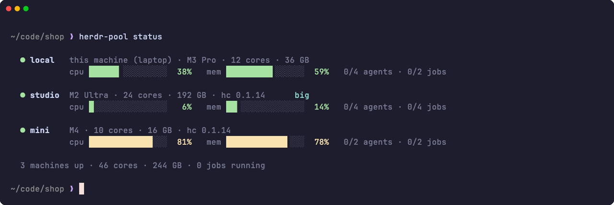
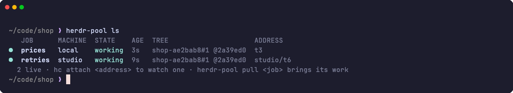
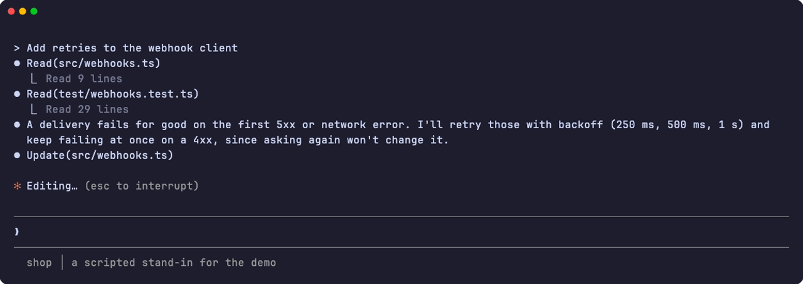
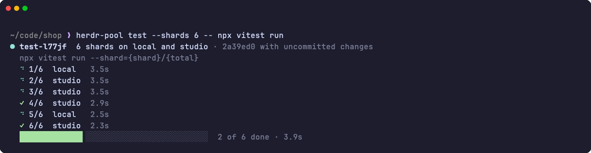
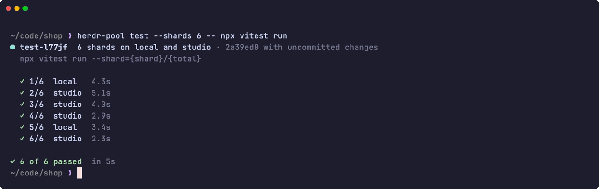
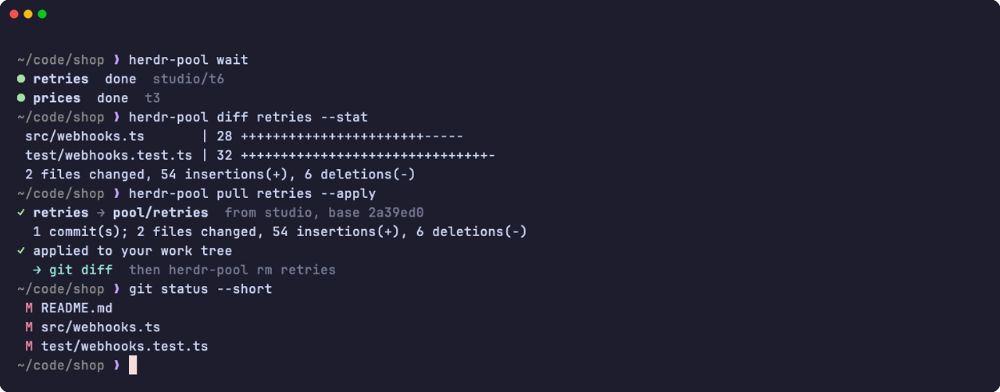

# herdr-pool

Your machines as one pool for coding agents and test runs, built on
[herdr-core](https://github.com/herdrdev/herdr-core) (`hc`).

```sh
herdr-pool run claude "Fix the flaky test in src/auth.ts"   # on whichever machine has room
herdr-pool test -- npx vitest run                           # one suite, split across machines
herdr-pool pull fix-the-flaky --apply                       # the agent's work, into your tree
```

hc already runs terminals that outlive you, on any machine you add, and routes an
agent's reports to the terminal that started it, across machines too. What it leaves
to you is the part that makes several Macs feel like one: deciding **where** work
goes, getting **your code** there, and bringing the **work back**. herdr-pool does
those three things and nothing else. It keeps no daemon and no state of its own
beyond a cache.

<p align="center">
  
</p>
<p align="center"><sub>
  64 seconds, unedited (<a href="docs/media/demo.mp4">MP4</a>). The machines, their hardware and load, the
  repository and the agents are synthetic: three hc cores on one Mac reporting made-up specs, and a script
  standing in for Claude Code. herdr-pool, hc, the snapshots, work trees, test shards and the change brought
  back are real. <a href="docs/demo">How it was recorded.</a>
</sub></p>

## Install

```sh
sh scripts/install.sh    # builds, installs ~/.local/bin/herdr-pool and the agent skill
herdr-pool init          # sets the pool up (install.sh offers to run it)
```

`init` walks you through it, asking before it changes anything:

1. **hc here.** If this machine lacks it, `init` offers its official installer.
2. **Your other machines.** It lists the hosts in your ssh config and your
   Tailscale peers. It looks only at the ones ssh already knows (their host key is in
   `known_hosts`), without a prompt and read-only, to show each one's chip, cores,
   memory and hc. You pick which ones join.
3. **Getting in.** The pool reconnects without you, so ssh must log in on its own. For
   a machine that wants a login, `init` offers to install your ssh key there
   (`ssh-copy-id`) or to try another user name. For one ssh hasn't seen yet, it
   lets you check its host key once.
4. **hc there.** It asks before copying hc to machines that lack it (or have
   one too old to work with this one).
5. **Ready to work.** For each machine it reads the login PATH, copies your hc
   templates, and checks git, the agents and disk. It offers to set your git
   identity where it is missing and to update hc where it is behind.
6. **The skill.** It installs or updates the agent skill for Claude Code.

One machine at a time: `herdr-pool add` (pick from what was found),
`herdr-pool add user@host`, or `herdr-pool add --via '<command>' --name N` for
machines you reach some other way (`fly ssh console -a app --pty=false -C`).
Without a terminal (scripts, agents), `add` behaves like
`hc machine add --install` and asks nothing. `herdr-pool doctor` checks
everything later; `doctor --fix` puts right what it can, asking first (without a
terminal it changes only what `--yes` allows).

**Claude Code's folder trust.** Claude Code asks before it works in a folder it
hasn't seen, and an agent in a new pool tree would sit at that question. It keys
that trust by the tree's repository, which for pool trees is the mirror the pool keeps
on each machine. So when you `run` Claude Code, herdr-pool records the trust
Claude Code's own message suggests (`projects[<mirror>].hasTrustDialogAccepted`
in `~/.claude.json` there). It does this once per repository and machine, and again
after a run where Claude Code didn't take its task, and only where Claude Code is set
up already. The file is replaced whole, and only if nothing changed it meanwhile.
`trust = false` in the config turns it off; agents then wait at the question until
you answer it with `hc attach`.

## A session

What the video shows, a step at a time, from inside a repository.

**See the pool.** `status` shows each machine's chip, cores and memory, how busy
its CPU and memory are, and how many pool agents and jobs it runs against its caps.
Here the laptop you type on is at 38%, the studio is nearly idle and tagged `big`,
and a small mini is busy with somebody's dev servers:



**Hand out work.** `run` takes a snapshot of your work tree with your uncommitted
changes, sends the machine only what it lacks of it (480 bytes here), gives the job
a work tree of its own there with its dependencies installed, and starts the agent
on its task. It ends with what to do next:


The first agent went to the idle studio. The second, started the same way, went to
the laptop: studio already ran one, and the mini is busy.

**Follow it.** `ls` lists jobs on every machine, and its ADDRESS column is what hc
takes. `hc attach studio/retries` (a job's name works as well as its address) puts
your terminal on the agent's, on the other machine; `ctrl+\` comes back and leaves
it running:





**Test while they work.** `test` splits a suite into shards over the machines with
room, on a snapshot of what you have now, so you can go on editing. A live board
follows the shards; then you get a line per shard, and the end of the output of any
that failed:





Studio took four shards, as many as its `max_jobs` allows, and the laptop two. The
mini, at 81% CPU, would have been next.

**Bring the work back.** `wait` returns when the agents are done, `diff` shows what
one changed, and `pull --apply` brings its work back as branch `pool/retries` and
applies it to your work tree, beside your own uncommitted change:



`herdr-pool rm retries` then ends the job and gives its tree back. With the skill
installed, Claude Code does the same on its own: it starts jobs with `run`, waits
for them and pulls their work ([For agents](#for-agents)).

### Where work goes

Machines differ, and so does how busy they are. Every time it places a job,
herdr-pool asks each machine for its load and scores the ones with room. The
lowest score wins:

- **Agents** mostly wait on a model, so what counts most is how many the machine
  already runs against its `max_agents`, then its CPU and memory.
- **Commands and test shards** use the CPU, so its load counts most, then how
  many it runs against `max_jobs`, then memory.
- This machine starts a little ahead, since nothing has to be copied to it.
  `weight` in the config favours a machine, `--needs big` keeps a job to machines
  tagged `big`, and `--on` picks one yourself.

## What happens on `run`

1. **Place.** Every machine reports CPU load, free memory, and how many pool
   agents and jobs it runs. The job goes to the machine with the lowest score
   that still has room. Room is `max_agents` for agents and `max_jobs` for
   commands and test shards. Agents you started by hand count while they are
   working. `--on` picks the machine yourself; `--needs big` limits the choice
   to tagged machines.
2. **Snapshot.** Your work tree as it is now (uncommitted and untracked files
   included, ignored ones left out) becomes a commit, built in a scratch index.
   Your index and files are never touched.
3. **Ship.** Each machine keeps a bare mirror of the repository, seeded from
   `origin` the first time. Only the objects it lacks travel, as a git bundle over
   hc's connection: usually a few kilobytes. On this machine the mirror is a
   hardlinked clone and nothing is copied.
4. **Lease a tree.** Each job gets its own git worktree, leased through a
   compare-and-swap document in that machine's hc core, so two runs never get
   the same one. Trees are reused: the next job resets to its own snapshot but
   keeps ignored files (`node_modules`, `target/`). Dependencies are installed
   again only when the lockfile changes.
5. **Start.** An hc terminal in that tree, labelled with the job's name, tree
   and base, so hc itself is the registry. The PATH is the machine's login-shell
   PATH. A core started over ssh gets a bare PATH where Homebrew, node and the
   agents are missing.
6. **Tell the agent.** Agents get a short footer on their task: where they are,
   and the exact `hc send <address>` that reaches their parent. On another
   machine that address is not `$HC_TERMINAL_ID`; herdr-pool works out the right one.

`pull` packs the tree's commits and uncommitted changes into one bundle, brings
it back as branch `pool/<job>`, and with `--apply` applies the changes to your
work tree.

### What your machines keep

A machine that ran a job keeps a copy of the repository under its pool root
(`~/.herdr-pool` unless `root` says otherwise). The mirror holds its history:
every branch of `origin` where that machine can fetch from it, otherwise the full
history behind the snapshots it was sent. The work trees hold a checkout with dependencies and
build output. `rm` and `gc` give trees back but keep them warm, `gc --purge`
deletes the free ones, and the mirror stays until you delete it:

```sh
herdr-pool repos                          # what each machine keeps: size, trees, jobs, origin
herdr-pool repos rm                       # this repository's copies, on every machine
herdr-pool repos rm org/api --on studio   # a named one, on some machines
herdr-pool repos rm --all                 # every repository's, and the pool's folder with them
```

A copy stays where a job still runs in it, or where a job left work you haven't
pulled (`--force` drops that work); a machine that is out of reach keeps its copy
until you run it again. Claude Code keeps its own records of agents that worked
there: their session logs (`~/.claude/projects/<tree>`) stay unless you add
`--agent-logs`, and its entry for the repository in `~/.claude.json` stays.

## Commands

| | |
|---|---|
| `status` | Machines: state, CPU, free memory, agents and jobs against their caps |
| `run <prog> [task]` | Start an agent, template or command where there is room (`--on`, `--needs`, `--count N`, `--here`, `--wait-slot`) |
| `ls` | Jobs on every machine, with state and tree |
| `wait [job...]` | Until they stop working (`--any`, `--tail N`). Inside hc, `hc wait --children` does this |
| `diff <job>` / `cat <job> <path>` | Its changes so far, or a file from its tree |
| `pull <job>` | Its work as branch `pool/<job>`; `--apply` puts it in your work tree |
| `rm <job...>` | End it and give its tree back. Refuses while it has unpulled work (`--force`) |
| `test [-- cmd]` | One suite split across machines; a line per shard, failures' tails, exit code |
| `each -- <cmd>` | A shell command on every machine at once |
| `gc` | Give back trees of finished jobs and remove finished terminals (`--purge` deletes free trees) |
| `repos [rm [repo]]` | What each machine keeps of your repositories; `rm` deletes it (`--all`, `--on`, `--agent-logs`) |
| `init` | Set the pool up: find your machines, help ssh in, install hc, check them, install the skill |
| `add [target]` | Add a machine: pick from those found, `user@host`, or `--via '<command>' --name N` |
| `doctor [--fix]` | Check hc, git, the agents and disk everywhere; `--fix` puts right what it can |
| `refresh` | Ask machines' login PATH again and copy your hc templates there (was `setup`) |
| `skill [install]` | The agent skill: print it, or install it in every `~/.claude*/skills` |

Every command takes `--help`, and the ones that report take `--json`.

## Working with hc

herdr-pool decides where a job runs and moves its code; hc is how you see and talk
to it. Every job is an hc terminal, and the ADDRESS column of `ls` (`t3`, or
`studio/t3` on another machine) is what `hc` takes. herdr-pool has no attach of
its own.

```sh
herdr-pool run claude "Fix the flaky test"   # prints its address, e.g. t3
hc attach t3                                 # watch or take over; ctrl+\ detaches
hc send t3 "now add a test for it"           # a prompt, without attaching
herdr-pool pull fix-the-flaky                # its work, as branch pool/fix-the-flaky
herdr-pool rm fix-the-flaky                  # end it and give its tree back
```

| | herdr-pool (job names) | hc (addresses) |
|---|---|---|
| Start | `run`: picks the machine, snapshots your repo into a tree | `hc run [--on M]`: a terminal where you say, no tree |
| Watch | `ls`, `diff`, `cat` | `hc attach`, `hc read`, bare `hc` to pick one |
| Talk | | `hc send`, `hc keys t3 esc`, `hc interrupt` |
| Wait | `wait <job>` | `hc wait <t>` (`--output X`, `--children`) |
| End | `rm`: the terminal and its tree | `hc kill`: only the program; the tree stays taken |

End pool jobs with `rm`, not `hc kill`, so the tree goes back. A job started outside
a git repository has no tree (`-` in `ls`): it is a plain hc terminal, and `pull`
has nothing to bring back.

## Without herdr: Rex, tmux, any terminal

herdr-pool doesn't need herdr, the app. Everything it does goes through hc
(herdr-core), a program of its own with no window: it keeps terminals alive on
each machine and reaches the other machines over ssh. `init` installs it where it's
missing, or:

```sh
curl -fsSL https://releases.herdr.dev/core/install.sh | sh
```

So any terminal works: Rex, Ghostty, iTerm2, the one in your editor, tmux, or an
ssh session. Jobs don't belong to the terminal that started them; they keep running
when it closes, and any terminal can look in with hc.

**In Rex.** Run herdr-pool in a block like any command, and give a job a block of
its own when you want to watch it:

```sh
rex split -- hc attach studio/retries                   # the agent on studio, beside you
rex run --split=below --ratio 35 -- herdr-pool test     # a test run in a block underneath
herdr-pool run --keep --on studio --name dev -- npm run dev
rex run -- hc attach studio/dev                         # that server, in a window of its own
```

`ctrl+\` detaches and leaves the job running; bare `hc` lists every terminal to pick
one.

**tmux and the rest.** Whatever opens a terminal will do:
`tmux split-window 'hc attach studio/retries'`, a new tab, or `hc attach` right
where you are.

**Agents outside hc.** Claude Code in a Rex block, or anywhere outside an hc
terminal, uses the pool through the skill all the same. hc can only type an
agent's report into an hc terminal, so it waits with `herdr-pool wait <job>
--tail 20` instead of `hc wait --children`, and the footer on the job's task asks
that agent to end with a short summary.

## For agents

`skills/herdr-pool/SKILL.md` is about 2.8 KB (roughly 700 tokens). It loads only
when a task calls for it, and it covers the whole workflow, so an agent doesn't
need hc's manual.
The CLI is written for agents as much as for people:

- **Short output.** `run` prints one line. `test` prints a line per shard and
  only the tail of failures. Colour, live progress and questions appear only
  when a person is at a terminal. Captured output, which is what agents see, stays plain
  and stable (`HERDR_POOL_PLAIN=1` forces plain; `NO_COLOR` drops colour).
- **No polling.** Agents in hc terminals get reports and notes typed in, and
  wait with `hc wait --children`.
- **Clear failures.** A full pool, a busy tree, unpulled work or a template that
  never got its task each comes back as one line that says what to do next.

## Use cases

- **Fan out.** Several agents on independent pieces, each in its own tree, then
  `pull --apply` the ones you keep. Your machine stays free for you.
- **Best of N.** `run --count 3 claude "..."` starts three attempts, on three machines
  when there is room. Compare them with `diff` and keep one.
- **Review swarm.** A `reviewer` template on N files at once:
  `run reviewer "Review src/a.ts"` for each file.
- **Tests while you keep editing.** `test` runs a snapshot, so you can go on
  changing files. Split across machines, a 10-minute suite takes a fraction of
  that.
- **OS or arch matrix.** `test --each -- cargo test` runs the whole suite on every
  machine, for example your Macs and a Linux box.
- **Offload a heavy build.** `run --needs big -- cargo build --release`, then
  `cat <job> target/release/x > x` for an artifact.
- **Long-running servers.** `run --keep --on studio -- npm run dev` keeps it up on
  another machine, and `hc wait studio/t3 --output ready` waits until it's ready.
- **Overnight queues.** `--wait-slot=3600` waits for room instead of failing, so a
  script can start more jobs than fit at once.
- **Fleet chores.** `each -- brew upgrade`, `each -- claude update`,
  `each -- 'df -h ~'`.

## Config

`~/.config/herdr-pool/config.toml` is optional; `herdr-pool help config` prints
every field.

```toml
[defaults]
max_agents = 8      # agents a machine takes at once
max_jobs = 2        # commands and test shards at once

[machine.studio]
max_jobs = 4
tags = ["big"]
weight = 1.5        # favour it

[repo."acme/web"]
setup = "npm ci --prefer-offline"
test = "npx vitest run --shard={shard}/{total}"
```

A repository can carry its own `.herdr-pool.toml` with `setup`, `setup_when`
and `test`. Without one, setup comes from the lockfile (npm, pnpm, yarn or bun).

## Limits

- One job runs on one machine. herdr-pool splits work that can be split
  (agents, test shards); it doesn't spread one process over several machines.
- Submodule contents don't travel in snapshots; their pinned commits do.
- Each machine needs its own agent logins, toolchains and git identity.
  `doctor` checks for those.
- `init` looks at your machines with `ssh -o BatchMode=yes`, which stops ssh's own
  questions but not an ssh agent's: with 1Password, Secretive or a security key you
  may be asked to approve (or touch) once for each machine it looks at.
- Trust is hc's: anyone who can reach your hc socket can run commands on every
  machine you added. Sessions are not a security boundary.

## Development

```sh
cargo test                                       # unit tests, real git included
cargo build --release && sh tests/integration.sh  # end to end with real hc
HPIT_REMOTE=you@other-mac sh tests/integration.sh # ... with a real second machine
cargo build --release && sh docs/demo/record.sh   # the video and stills above, again
```

[`docs/demo`](docs/demo) holds the synthetic pool behind the video and says how to
record it again or look around in it.

The integration test runs a scratch hc session plus two more on the same host,
standing in for other machines. With `HPIT_REMOTE`, machine `b` is that host
over ssh instead, running a scratch core whose files all stay in one folder
under `/tmp` there. It never touches your own sessions, config, templates or
Claude Code config on either machine (its cores get a scratch
`CLAUDE_CONFIG_DIR`), and it stops every core it started.
